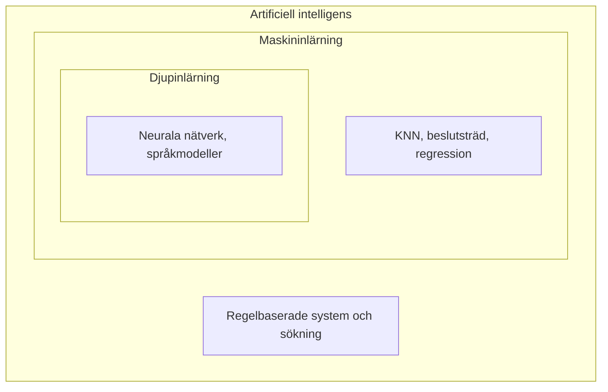
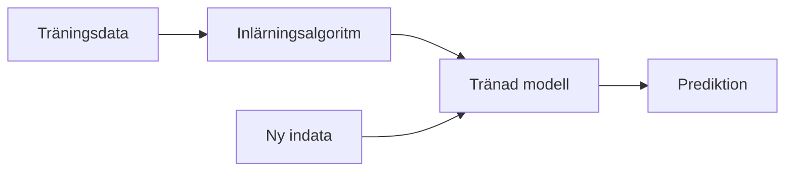

# Kapitel 1: Vad är artificiell intelligens?

> **I det här kapitlet lär du dig**
> - vad AI är, och vad som skiljer AI från vanliga datorprogram
> - de viktigaste begreppen: modell, träning, data och prediktion
> - varför AI har utvecklats så snabbt de senaste åren
> - var AI används och vilka tekniker som ligger bakom

Du har troligen redan använt AI i dag. Mobilen låste upp sig när den såg ditt ansikte, flödet i din app valde vad du skulle se, och skräpposten försvann innan du hann läsa den. Samtidigt är ordet AI otydligt: det används om allt från en chattbott till en smart dammsugare. Det här kapitlet ger dig en karta över området, så att resten av boken har någonstans att landa.

## Vad menas med AI?

**Artificiell intelligens** är datorprogram och robotar som utför uppgifter vi annars skulle säga kräver mänsklig intelligens, till exempel att känna igen ansikten, förstå språk eller fatta beslut i ett spel.

EU:s AI-förordning har en mer juridisk definition. Fritt återgivet är ett AI-system ett maskinbaserat system som, med en viss grad av självständighet, utifrån indata själv härleder hur det ska skapa utdata i form av förutsägelser, innehåll, rekommendationer eller beslut. Nyckelordet är *härleder*: svaret är inte uttryckligen programmerat rad för rad.

Det finns en viktig skillnad mellan två sorters AI:

| Typ | Vad det betyder | Status |
|---|---|---|
| **Smal AI** | Bra på en avgränsad uppgift, till exempel att spela schack eller översätta text | All AI vi använder i dag räknas oftast hit |
| **Generell AI (AGI)** | Skulle klara i princip alla intellektuella uppgifter en människa klarar | Finns inte i dag enligt de flesta bedömare, och forskare är oeniga om när eller om den kommer |

Maskininlärning är en del av AI, och djupinlärning är en del av maskininlärning.



## Regler eller inlärning: ett genomgånget exempel

Det finns två grundläggande sätt att få en dator att sortera bort skräppost. Det första är att skriva **regler** själv: om meddelandet innehåller "vinn pengar", släng det. Det andra är **maskininlärning**: du ger programmet exempel med rätt svar och låter det hitta mönstren.

Här är en mycket liten version av det andra sättet. Kör koden i till exempel [Google Colab](https://colab.research.google.com/).

```python
# Ett litet "skräppostfilter" som lär sig av exempel
from collections import Counter

träning = [
    ("vinn pengar nu", "skräp"),
    ("gratis pengar klicka här", "skräp"),
    ("klicka och vinn en resa", "skräp"),
    ("ses vi på lektionen", "ok"),
    ("har du läxan till lektionen", "ok"),
    ("ska vi äta lunch nu", "ok"),
]

# Träning: räkna hur ofta varje ord förekommer i varje klass
ord_per_klass = {"skräp": Counter(), "ok": Counter()}
for text, klass in träning:
    ord_per_klass[klass].update(text.split())

def klassa(text):
    poäng = {"skräp": 0, "ok": 0}
    for ord in text.split():
        for klass in poäng:
            poäng[klass] += ord_per_klass[klass][ord]
    svar = "skräp" if poäng["skräp"] > poäng["ok"] else "ok"
    return svar, poäng

for text in ["klicka här för gratis resa", "ses vi efter lunch", "vinn lunch nu"]:
    print(text, "->", klassa(text))
```

```text
klicka här för gratis resa -> ('skräp', {'skräp': 5, 'ok': 0})
ses vi efter lunch -> ('ok', {'skräp': 0, 'ok': 4})
vinn lunch nu -> ('skräp', {'skräp': 3, 'ok': 2})
```

Titta på den sista raden. Ordet "vinn" har förekommit 2 gånger i skräp, "nu" 1 gång i skräp och 1 gång i ok, och "lunch" 1 gång i ok. Det ger 3 mot 2, och meddelandet klassas som skräp. Det kanske är fel! Modellen vet inte vad en lunch är. Den har bara räknat ord i sex exempel. Här syns tre saker som gäller nästan all AI:

1. Programmet har inga skrivna regler om skräppost. Reglerna kommer från **data**.
2. Med lite data blir modellen osäker.
3. Modellen kan ha fel utan att märka det.

## Centrala begrepp

När du tränar en modell händer samma sak varje gång: data går in, en algoritm justerar modellen, och den färdiga modellen används på nya fall.



Här kommer de begrepp du behöver från början.

- En **algoritm** är en steg-för-steg-beskrivning av hur något ska göras.
- En **modell** är det som blir kvar efter träningen, ofta en stor mängd tal.
- **Träning** är när modellen anpassas efter data.
- En **prediktion** är modellens svar på ett nytt fall.
- En **egenskap** (på engelska *feature*) är en mätbar uppgift, till exempel ett ord eller en längd.
- En **etikett** (*label*) är det rätta svaret i träningsdata.

Det finns tre huvudsakliga sätt att lära en modell:

| Lärande | Vad modellen får | Exempel |
|---|---|---|
| **Övervakat** | Data med rätt svar | Skräppost eller inte, huspris |
| **Oövervakat** | Data utan svar, ska hitta grupper själv | Dela in kunder i grupper |
| **Förstärkningsinlärning** | Belöning eller straff efter sina handlingar | En agent som lär sig spela ett spel |

## Varför nu? Drivkrafterna bakom AI

Idéerna är gamla. Alan Turing skrev 1950 om huruvida maskiner kan tänka, och uttrycket *artificial intelligence* användes vid ett känt forskningsmöte i Dartmouth 1956. Därefter har området gått i vågor, med perioder av stora förhoppningar och perioder av besvikelse, ibland kallade AI-vintrar. Några milstolpar:

| Årtal | Händelse |
|---|---|
| 1997 | Schackdatorn Deep Blue besegrar världsmästaren Garri Kasparov |
| 2012 | Ett djupt neuralt nätverk (AlexNet) vinner en stor bildigenkänningstävling med god marginal |
| 2016 | AlphaGo besegrar Lee Sedol, en av världens bästa go-spelare |
| 2017 | Artikeln om transformer-arkitekturen publiceras |
| 2022 | ChatGPT släpps i november och blir känt för en bred allmänhet |

Att utvecklingen tog fart beror på flera drivkrafter som samverkar:

- **Data.** Internet och mobiler har skapat enorma mängder text, bilder och ljud.
- **Beräkningskraft.** Grafikprocessorer (GPU:er) kan göra väldigt många enkla beräkningar samtidigt.
- **Bättre algoritmer.** Djupinlärning och transformer-modellen gjorde stora modeller träningsbara.
- **Pengar och konkurrens.** Företag och stater investerar stort eftersom AI kan ge ekonomiska och militära fördelar.
- **Öppenhet.** Forskningsartiklar, öppen kod och färdiga bibliotek gör att nya idéer sprids snabbt.

## Var används AI?

| Område | Exempel | Vanliga tekniker |
|---|---|---|
| **Prediktion** | Väderprognoser, bedöma risk för maskinhaveri, rekommendationer | Regression, beslutsträd, neurala nätverk |
| **Vision** | Ansiktsupplåsning, tolka röntgenbilder, känna igen fotgängare | Klassificering, objektigenkänning, neurala nätverk |
| **Robotik** | Lagerrobotar, industrirobotar, självkörande fordon | Sensorer, sökning och vägplanering, förstärkningsinlärning |
| **Generativ AI** | Skriva text, skapa bilder, föreslå programkod | Stora språkmodeller, diffusionsmodeller |
| **Språk (NLP)** | Översättning, röststyrning, sammanfattning | Språkmodeller, klassificering av text |

Tre tekniker återkommer ofta, och du kommer att prova alla:

- **Sökning** betyder att systematiskt gå igenom möjliga lösningar, som att hitta kortaste vägen på en karta.
- **Klassificering** betyder att välja rätt kategori, till exempel skräp eller inte skräp.
- **Objektigenkänning** betyder att hitta och namnge saker i en bild, och ange var de finns.

## Begrepp

- **AI:** program och robotar som utför uppgifter som annars anses kräva mänsklig intelligens
- **Maskininlärning:** AI som lär sig mönster från data i stället för färdiga regler
- **Djupinlärning:** maskininlärning med neurala nätverk i många lager
- **Modell:** resultatet av träningen, som används för att göra prediktioner
- **Egenskap och etikett:** det modellen tittar på, och det rätta svaret
- **Generativ AI:** AI som skapar nytt innehåll som text, bilder eller kod
- **NLP:** datorers tolkning och bearbetning av mänskligt språk

## Testa dig själv

1. Förklara skillnaden mellan smal och generell AI med ett exempel på vardera.
2. Vad betyder det att ett AI-system *härleder* sitt svar?
3. Varför klassades "vinn lunch nu" som skräp i exemplet?
4. Vad är skillnaden mellan träningsdata och ny indata?
5. Nämn tre drivkrafter bakom AI-utvecklingen. Vilken tror du är viktigast? Motivera.
6. Är en miniräknare AI? Är en app som föreslår nästa ord? Motivera.

## Koppling till projektet

Kapitlet ger grunden till [AI LLMer](../projekt/ai-llmer/README.md), där du börjar med att ta reda på vad generativ AI är. Begreppen om modell, träning och data används igen i [AI - Projekt](../projekt/ai-projekt/README.md).

## Läs mer

- [EU-kommissionen om regelverket för AI](https://digital-strategy.ec.europa.eu/en/policies/regulatory-framework-ai)
- [Attention Is All You Need (artikeln om transformers)](https://arxiv.org/abs/1706.03762)
- [scikit-learn, biblioteket vi använder för maskininlärning](https://scikit-learn.org/stable/)

[← Föregående](../README.md) | [Innehåll](../README.md) | [Nästa →](02-sprakmodeller.md)
