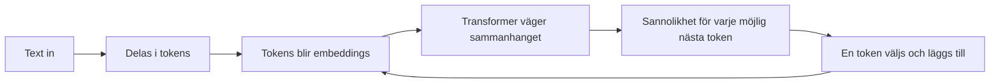

# Kapitel 2: Hur fungerar en språkmodell?

> **I det här kapitlet lär du dig**
> - vad generativ AI och stora språkmodeller är
> - vad tokens är och hur en modell förutsäger nästa ord
> - vad embeddings är och hur modellen hanterar betydelse
> - hur en språkmodell tränas, och varför den ibland hittar på

När du skriver till en chattbott känns det som att någon svarar. I själva verket gör modellen en enda sak om och om igen: den räknar ut vad som troligen kommer härnäst i texten. Att det räcker för att skriva uppsatser och programkod är ett av de mest överraskande resultaten inom AI.

## Generativ AI och LLM

**Generativ AI** är AI som skapar nytt innehåll, till exempel text, bilder eller ljud. En **stor språkmodell** (*large language model*, LLM) är en generativ modell som tränats på enorma mängder text. Exempel på tjänster som bygger på LLM:er är ChatGPT och Claude.

Modeller av det här slaget är kraftfulla på att skriva, sammanfatta, översätta och föreslå kod. De har också tydliga svagheter:

| Begränsning | Vad det innebär |
|---|---|
| **Kunskapsgräns** | Modellen känner bara till det som fanns i träningsdatan, om den inte får ny information |
| **Hallucination** | Modellen kan formulera påhitt lika övertygande som fakta |
| **Begränsat minne** | Bara en viss mängd text får plats i taget (kontextfönstret) |
| **Bias** | Modellen kan återge fördomar som finns i träningsdatan |

## Tokens

En språkmodell läser inte bokstäver eller hela ord. Texten delas i **tokens**, små bitar som kan vara ett helt ord, en del av ett ord eller ett skiljetecken. Långa svenska sammansättningar delas ofta i flera tokens. Varje token får ett nummer, och det är numren som modellen räknar med.

Tokens spelar roll i praktiken. Kontextfönstret mäts i tokens, och betaltjänster tar ofta betalt per token.

## Förutsäga nästa ord: ett genomgånget exempel

Den enklaste tänkbara språkmodellen räknar bara vilket ord som brukar följa på vilket. Det kallas en bigrammodell. Här delar vi upp texten vid mellanslag, så varje ord och punkt blir en token.

```python
# En mycket liten språkmodell: räkna vilket ord som följer på vilket
from collections import Counter, defaultdict

text = """katten sitter på mattan . hunden sitter på golvet .
katten jagar musen . hunden jagar katten . musen sitter på mattan ."""
tokens = text.split()

följare = defaultdict(Counter)
for nu, nästa in zip(tokens, tokens[1:]):
    följare[nu][nästa] += 1

def sannolikheter(ord):
    antal = följare[ord]
    totalt = sum(antal.values())
    return {nästa: round(n / totalt, 2) for nästa, n in antal.most_common()}

print("Antal tokens:", len(tokens))
print("efter 'sitter':", sannolikheter("sitter"))
print("efter 'på':", sannolikheter("på"))
print("efter 'katten':", sannolikheter("katten"))

# Generera text genom att välja det vanligaste nästa ordet
ord, mening = "hunden", ["hunden"]
for _ in range(4):
    ord = följare[ord].most_common(1)[0][0]
    mening.append(ord)
print(" ".join(mening))
```

```text
Antal tokens: 23
efter 'sitter': {'på': 1.0}
efter 'på': {'mattan': 0.67, 'golvet': 0.33}
efter 'katten': {'sitter': 0.33, 'jagar': 0.33, '.': 0.33}
hunden sitter på mattan .
```

Efter "på" kommer "mattan" i två av tre fall, alltså sannolikheten 0,67. Så skapas text: välj ett nästa ord, lägg till det och upprepa.

En riktig LLM gör i princip samma sak, men med en stor skillnad. Bigrammodellen tittar bara på ett ord bakåt. En LLM väger in hela texten den fått. I meningen "Banken vid ån var hal, så jag ramlade på ..." behöver modellen förstå att "banken" handlar om en strand och inte om pengar. Tekniken som gör det kallas **attention**, och modelltypen kallas **transformer**. Modellen beräknar vilka tidigare ord som är viktiga för just nästa token.



## Temperature: hur modigt väljer modellen?

Modellen får en sannolikhet för varje möjlig nästa token. Inställningen **temperature** (T) styr hur den väljer. Vid låg temperature väljs nästan alltid det troligaste. Vid hög temperature får mindre troliga ord större chans. Ett vanligt sätt att räkna är att upphöja varje sannolikhet med 1/T och sedan skala om så att summan blir 1.

```python
# Hur temperature ändrar sannolikheterna
import numpy as np

ord = ["mattan", "golvet", "månen"]
p = np.array([0.70, 0.25, 0.05])

for T in [0.2, 1.0, 2.0]:
    q = p ** (1 / T)
    q = q / q.sum()
    print(f"T={T}:", dict(zip(ord, q.round(3).tolist())))
```

```text
T=0.2: {'mattan': 0.994, 'golvet': 0.006, 'månen': 0.0}
T=1.0: {'mattan': 0.7, 'golvet': 0.25, 'månen': 0.05}
T=2.0: {'mattan': 0.536, 'golvet': 0.32, 'månen': 0.143}
```

En låg temperature passar när du vill ha förutsägbara svar, och en högre när du vill ha variation.

## Embeddings: betydelse som tal

För att kunna räkna med ord gör modellen om varje token till en lång lista med tal, en vektor. Den kallas **embedding** (på svenska ibland inbäddning). Under träningen hamnar ord som används i liknande sammanhang nära varandra i det här talrummet.

Likheten mäts ofta med **cosinuslikhet**, som ger ett värde nära 1 om två vektorer pekar åt nästan samma håll.

```python
# Inbäddningar: ord som vektorer, likhet som cosinus för vinkeln
import numpy as np

# Påhittade vektorer med tre dimensioner, bara för att visa principen
vektor = {
    "hund":  np.array([0.9, 0.8, 0.1]),
    "katt":  np.array([0.8, 0.9, 0.2]),
    "bil":   np.array([0.1, 0.2, 0.9]),
}

def cos_likhet(a, b):
    return np.dot(a, b) / (np.linalg.norm(a) * np.linalg.norm(b))

print("hund-katt:", round(cos_likhet(vektor["hund"], vektor["katt"]), 3))
print("hund-bil: ", round(cos_likhet(vektor["hund"], vektor["bil"]), 3))
```

```text
hund-katt: 0.99
hund-bil:  0.303
```

Riktiga embeddings har hundratals eller tusentals dimensioner. Principen är densamma, och den är grunden för sökning i RAG, som du möter i nästa kapitel.

## Hur tränas en LLM?

Träningen sker i flera steg.

1. **Förträning.** Modellen läser enorma textmängder och försöker förutsäga ord som döljs. När den gissar fel justeras modellens tal, de så kallade vikterna, lite grann. Det upprepas väldigt många gånger och kräver mycket datorkraft.
2. **Finjustering.** Modellen tränas vidare på mer specifika exempel, till exempel frågor och bra svar, ofta med hjälp av bedömningar från människor.
3. **Användning.** Den färdiga modellen lär sig normalt inte av varje ny fråga under samtalet. Den använder det den redan tränats på plus den text den får i kontextfönstret.

**BERT** är en känd modell från Google från 2018 och ett bra exempel på förträning. Den tränades bland annat på att gissa dolda ord i meningar (*masked language modeling*) och på att avgöra om en mening följer på en annan. BERT läser texten åt båda håll, vilket är smart för att förstå ord i sitt sammanhang. Efter förträningen kan BERT finjusteras för en särskild uppgift, till exempel att avgöra om en text är positiv eller negativ.

GPT-liknande modeller är i stället byggda framför allt för att fortsätta en text.

## Varför hallucinerar den?

Modellen är tränad att ge en sannolik fortsättning, inte att kontrollera om något är sant. Om den inte "vet" svaret finns det inget naturligt stopp som säger "det här vet jag inte". Därför kan den hitta på referenser, personer eller lagparagrafer. Metoder som RAG och finjustering minskar problemet men tar inte bort det.

## Begrepp

- **LLM:** stor språkmodell som tränats på mycket text
- **Token:** bit av text som modellen arbetar med
- **Kontextfönster:** hur mycket text modellen kan ta hänsyn till samtidigt
- **Embedding:** en vektor med tal som representerar en token eller text
- **Transformer och attention:** modelltyp och teknik som väger in sammanhanget
- **Temperature:** inställning som styr hur mycket slump som påverkar valet
- **Förträning och finjustering:** allmän träning, och anpassning till en uppgift
- **Hallucination:** ett påhittat men övertygande svar

## Koppling till projektet

Det här kapitlet förbereder de två första lektionerna i [AI LLMer](../projekt/ai-llmer/README.md). Du behöver begreppen när du jämför modellens "förståelse" med en människas och när du förklarar hur din app fungerar. I [AI - Projekt](../projekt/ai-projekt/README.md) återkommer BERT.

## Läs mer

- [Lektion 01: Intro to Generative AI (kursmaterialet)](https://github.com/abbjetmus/generative-ai-with-javascript/tree/main/lessons/01-intro-to-genai)
- [Attention Is All You Need](https://arxiv.org/abs/1706.03762)
- [Artikeln om BERT](https://arxiv.org/abs/1810.04805)

[← Föregående](01-vad-ar-ai.md) | [Innehåll](../README.md) | [Nästa →](03-bygga-med-llm.md)
