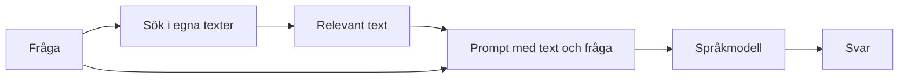
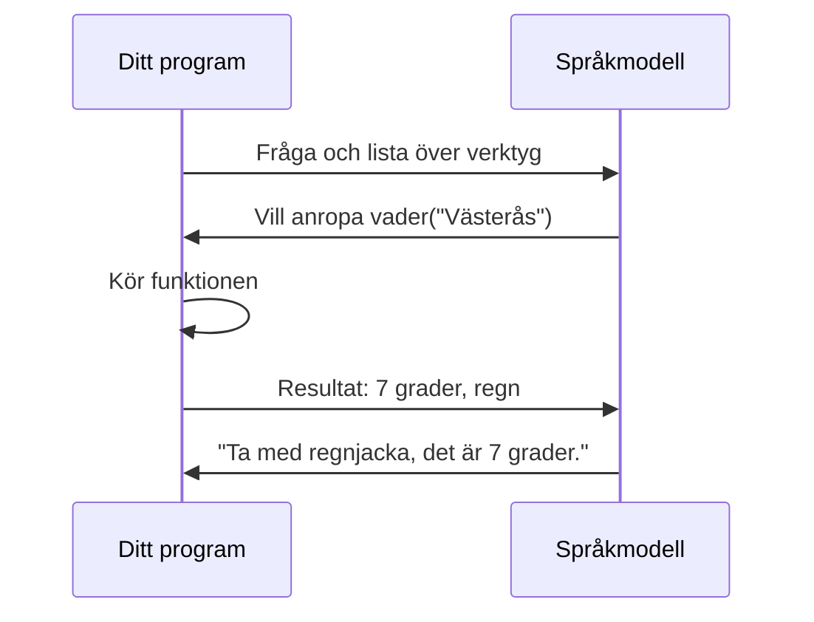

# Kapitel 3: Bygg program med en språkmodell

> **I det här kapitlet lär du dig**
> - hur ett program pratar med en språkmodell via ett API
> - vad ett systemmeddelande gör och hur du skriver bra prompter
> - hur du får strukturerade svar som programmet kan använda
> - vad RAG, verktygsanrop och MCP är

En chattbott är bara ett av många sätt att använda en språkmodell. Det intressanta börjar när ditt eget program kan skicka frågor till modellen och göra något med svaren. I det här kapitlet går vi igenom de byggstenar du behöver för att skapa en egen app.

Kapitlet följer lektionerna i kursmaterialet [Generative AI with JavaScript](https://github.com/abbjetmus/generative-ai-with-javascript/tree/main/lessons). Materialet berättar en historia om tidsresor och innehåller längre kodexempel. Här får du det viktigaste i kortare form.

## API och meddelanden

Ett **API** (*application programming interface*) är ett sätt för program att prata med varandra. Ditt program skickar en förfrågan till en tjänst och får ett svar. En språkmodell tar emot en lista med meddelanden, där varje meddelande har en roll:

| Roll | Innehåll |
|---|---|
| `system` | Instruktioner om hur modellen ska bete sig |
| `user` | Det användaren frågar |
| `assistant` | Modellens tidigare svar, så att samtalet hänger ihop |

Modellen minns inget mellan anrop. Vill du ha en chatt måste ditt program skicka med hela samtalet varje gång.

## Din första app

Kodexemplet använder JavaScript och biblioteket `openai`, som kan prata med många olika tjänster. Du behöver [Node.js](https://nodejs.org/) och en API-nyckel till en tjänst.

> **Så väljer du tjänst.** Delar av kursmaterialet använder GitHub Models. GitHub har [stängt den tjänsten](https://docs.github.com/en/github-models/quickstart), så de adresserna fungerar inte längre. Koden nedan läser därför in tjänstens adress, nyckel och modell från miljövariabler. Läraren berättar vilken tjänst kursen använder.

Skapa en mapp, kör `npm init -y` och `npm install openai`. Lägg sedan koden i `app.mjs`:

```javascript
import { OpenAI } from "openai";

const client = new OpenAI({
  baseURL: process.env.LLM_BASE_URL,
  apiKey: process.env.LLM_API_KEY,
});

const svar = await client.chat.completions.create({
  model: process.env.LLM_MODEL,
  messages: [
    { role: "system", content: "Du är en tålmodig lärare. Svara kort och på svenska." },
    { role: "user", content: "Vad är en token i en språkmodell?" },
  ],
  temperature: 0.2,
});

console.log(svar.choices[0].message.content);
```

Prova att ändra systemmeddelandet till "Du svarar som en pirat", och höj `temperature`. Samma fråga kan nu ge ganska olika svar.

**Skydda din nyckel.** En API-nyckel är som ett lösenord. Skriv den aldrig i koden, ladda aldrig upp den till GitHub, och dela den inte med någon. Lägg den i en miljövariabel eller i en `.env`-fil som står i `.gitignore`.

## Promptteknik

En **prompt** är instruktionen du ger modellen. Tre vanliga tekniker:

| Teknik | Hur | Exempel |
|---|---|---|
| **Zero-shot** | Bara uppgiften, inga exempel | Avgör om recensionen är positiv eller negativ |
| **Few-shot** | Ge några exempel först | "Bra film" = positiv, "Tråkig" = negativ. Nu: "Helt okej" = ? |
| **Chain-of-thought** | Be modellen resonera steg för steg | Visa hur du räknar, steg för steg, och ge svaret sist |

En bra prompt är konkret. Jämför två varianter:

> Sämre: Skriv om AI.

> Bättre: Du skriver för en gymnasieelev. Förklara vad en token är på högst tre meningar, och ge ett exempel med ett svenskt ord.

## Strukturerad utdata

Ett program kan inte så lätt använda ett svar i fri text. Om du vill visa ett quiz vill du ha frågorna i ett bestämt format. Då ber du modellen svara i **JSON**, ett textformat som är lätt för program att läsa.

```javascript
import { OpenAI } from "openai";

const client = new OpenAI({
  baseURL: process.env.LLM_BASE_URL,
  apiKey: process.env.LLM_API_KEY,
});

const svar = await client.chat.completions.create({
  model: process.env.LLM_MODEL,
  messages: [
    {
      role: "system",
      content: 'Svara endast med JSON på formen {"fraga": "...", "alternativ": ["..."], "ratt": 0}.',
    },
    { role: "user", content: "Gör en quizfråga om tokens." },
  ],
  response_format: { type: "json_object" },
});

let quiz;
try {
  quiz = JSON.parse(svar.choices[0].message.content);
} catch {
  console.error("Modellen svarade inte med giltig JSON.");
  process.exit(1);
}

if (!Array.isArray(quiz.alternativ) || !quiz.alternativ[quiz.ratt]) {
  console.error("Svaret saknar giltiga alternativ.");
  process.exit(1);
}

console.log(quiz.fraga, "Rätt svar:", quiz.alternativ[quiz.ratt]);
```

Observera kontrollerna. Modellens svar kan vara fel även när du bett om ett visst format, så ditt program bör alltid kontrollera vad det får.

## RAG: låt modellen läsa din data

Modellen vet inget om din skolas schema eller dina anteckningar. **RAG** (*retrieval-augmented generation*) löser det i två steg: först söker programmet fram relevant text, sedan läggs den texten in i prompten.



Sökdelen kan du testa utan språkmodell. Det här exemplet gör om texterna till vektorer och väljer det stycke som liknar frågan mest.

```python
# Sökdelen i RAG: hitta det textstycke som bäst passar frågan
from sklearn.feature_extraction.text import TfidfVectorizer
from sklearn.metrics.pairwise import cosine_similarity

stycken = [
    "Biblioteket har öppet vardagar mellan åtta och sexton.",
    "Lån av böcker gäller i fyra veckor och kan förlängas en gång.",
    "Grupprummen bokas i receptionen minst en dag i förväg.",
]
fråga = "Hur länge får jag låna en bok och kan lån förlängas?"

vektoriserare = TfidfVectorizer()
stycke_vektorer = vektoriserare.fit_transform(stycken)
fråga_vektor = vektoriserare.transform([fråga])

likheter = cosine_similarity(fråga_vektor, stycke_vektorer)[0]
for stycke, likhet in zip(stycken, likheter):
    print(f"{likhet:.2f}  {stycke}")

bäst = stycken[likheter.argmax()]
prompt = f"Svara bara utifrån texten.\nText: {bäst}\nFråga: {fråga}"
print()
print(prompt)
```

```text
0.10  Biblioteket har öppet vardagar mellan åtta och sexton.
0.64  Lån av böcker gäller i fyra veckor och kan förlängas en gång.
0.11  Grupprummen bokas i receptionen minst en dag i förväg.

Svara bara utifrån texten.
Text: Lån av böcker gäller i fyra veckor och kan förlängas en gång.
Fråga: Hur länge får jag låna en bok och kan lån förlängas?
```

TF-IDF jämför bara vilka ord som förekommer, så "bok" och "böcker" räknas som olika ord. Riktiga RAG-system använder ofta embeddings, som också hittar texter med liknande betydelse.

## Verktygsanrop och MCP

Med **verktygsanrop** (*tool calling*) kan modellen be ditt program att köra en funktion, till exempel att hämta vädret. Det är viktigt att förstå att modellen inte kör något själv. Den föreslår ett anrop, ditt program kör funktionen, och resultatet skickas tillbaka.



Eftersom modellen kan föreslå vad som helst bör du aldrig låta den köra farliga kommandon utan kontroll.

**MCP** (*Model Context Protocol*) är en standard för hur verktyg och data kan kopplas till AI-program, så att varje koppling inte behöver byggas från början.

## Begrepp

- **API:** gränssnitt som låter program kommunicera
- **API-nyckel:** hemlig kod som ger tillgång till en tjänst
- **Systemmeddelande:** instruktion till modellen om hur den ska bete sig
- **Prompt:** det du skriver till modellen
- **Few-shot och chain-of-thought:** ge exempel, respektive be om resonemang steg för steg
- **JSON:** textformat för strukturerad data
- **RAG:** hämta relevant text och ge den till modellen
- **Verktygsanrop:** modellen ber ditt program köra en funktion
- **MCP:** standard för att koppla verktyg till AI-program

## Testa dig själv

1. Varför måste programmet skicka med hela samtalet i varje anrop?
2. Vad är skillnaden mellan zero-shot och few-shot?
3. Varför ska en API-nyckel inte skrivas direkt i koden?
4. Varför bör programmet kontrollera JSON-svaret från modellen?
5. Vilket problem löser RAG? Vilket löser den inte?
6. Vem är det som faktiskt kör en funktion vid verktygsanrop?

## Övningar

**Grund.** Skriv en zero-shot-prompt och en few-shot-prompt för samma uppgift. Testa båda och beskriv skillnaden.

**Vidare.** Lägg till ett fjärde textstycke i RAG-exemplet som handlar om att låna datorer. Ställ en fråga som gör att det nya stycket väljs. Ställ sedan en fråga med ett ord som inte finns i texterna. Vad händer?

**Vidare.** Lägg till en loop i din första app som frågar användaren och sparar samtalet i meddelandelistan.

**Utmaning.** Bygg en liten RAG-app som söker bland minst tio egna textstycken och ger ett svar med en språkmodell. Modellen ska säga "det vet jag inte" när texten saknar svaret. Testa flera frågor och redovisa när den misslyckas.

## Koppling till projektet

Det här kapitlet är ditt verktygskapitel för [AI LLMer](../projekt/ai-llmer/README.md). Du använder det från den första AI-appen till ditt egna program.

## Läs mer

- [Lektion 02: din första app](https://github.com/abbjetmus/generative-ai-with-javascript/tree/main/lessons/02-first-ai-app)
- [Lektion 03: promptteknik](https://github.com/abbjetmus/generative-ai-with-javascript/tree/main/lessons/03-prompt-engineering)
- [Lektion 04: strukturerad utdata](https://github.com/abbjetmus/generative-ai-with-javascript/tree/main/lessons/04-structured-output)
- [Lektion 05: RAG](https://github.com/abbjetmus/generative-ai-with-javascript/tree/main/lessons/05-rag)
- [Lektion 06: verktygsanrop](https://github.com/abbjetmus/generative-ai-with-javascript/tree/main/lessons/06-tool-calling)
- [Lektion 07: MCP](https://github.com/abbjetmus/generative-ai-with-javascript/tree/main/lessons/07-mcp)

[← Föregående](02-sprakmodeller.md) | [Innehåll](../README.md) | [Nästa →](04-manniska-och-ai.md)
