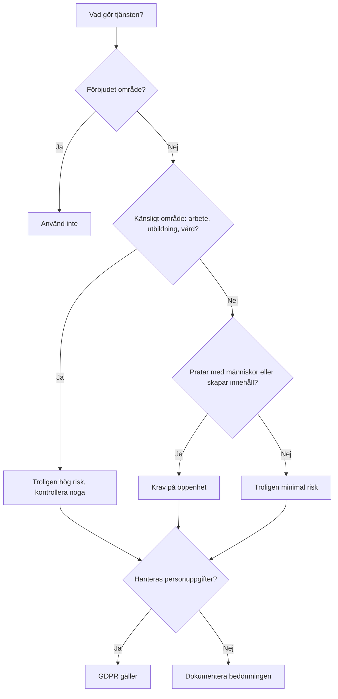

# Kapitel 5: Lagar, regler och normer

> **I det här kapitlet lär du dig**
> - vad som menas med normer, lagar och andra bestämmelser
> - hur EU:s AI-förordning delar in AI-system efter risk
> - vad GDPR innebär när AI hanterar personuppgifter
> - hur du gör en enkel bedömning av vilka regler som berör en AI-tjänst

Får en skola låta en AI bedöma elevers prov? Får ett företag använda en kamera som läser av anställdas känslor? Får du ladda upp en klasskamrats bild i en chattbott? Svaren styrs av regler som fortfarande håller på att införas. Därför lär du dig här inte bara vad reglerna säger just nu, utan också hur du tar reda på vad som gäller.

> **Viktigt.** Det här kapitlet är en förenklad introduktion och ingen juridisk rådgivning. AI-förordningen införs stegvis och tidplanen har redan ändrats en gång. Kontrollera alltid aktuell information hos [EU-kommissionen](https://digital-strategy.ec.europa.eu/en/policies/regulatory-framework-ai) och i den officiella lagtexten på [EUR-Lex](https://eur-lex.europa.eu/legal-content/SV/TXT/?uri=CELEX:32024R1689).

## Normer, lagar och andra bestämmelser

**Normer** är oskrivna eller frivilliga regler om vad som anses rimligt, till exempel att säga till när en text är AI-genererad. **Lagar** beslutas av riksdag eller EU och kan ge straff eller sanktionsavgifter. **Andra bestämmelser** kan vara myndighetsföreskrifter, standarder eller en skolas regler.

En EU-**förordning** gäller direkt i alla medlemsländer. Både AI-förordningen och GDPR är förordningar.

## EU:s AI-förordning

Förordningen, (EU) 2024/1689, är ett regelverk om AI-system som släpps ut eller används i EU. Den utgår från **risk**: ju större risk för människors hälsa, säkerhet och grundläggande rättigheter, desto hårdare krav.

| Risknivå | Vad det betyder | Exempel |
|---|---|---|
| **Oacceptabel risk** | Förbjudet | Sociala poängsystem, manipulation som skadar människor, känsloigenkänning på arbetsplatser och i utbildning (med vissa undantag) |
| **Hög risk** | Tillåtet med stränga krav | AI i kritisk infrastruktur, anställning och kreditbedömning, samt vissa användningar i utbildning |
| **Begränsad risk** | Krav på öppenhet | Användaren ska veta att hen pratar med en chattbott, och deepfakes ska märkas |
| **Minimal risk** | Inga särskilda krav | Skräppostfilter och AI i datorspel |

Inom utbildning kan hög risk till exempel gälla system som avgör antagning, bedömer studieresultat eller övervakar elever under prov. Kraven på sådana system handlar bland annat om riskhantering, datakvalitet, dokumentation, loggning och mänsklig tillsyn.

**Generella AI-modeller** (som stora språkmodeller) har egna regler. Leverantörerna ska bland annat ta fram dokumentation och ha en policy för upphovsrätt, och de allra kraftfullaste modellerna har ytterligare krav.

Förordningen skiljer på olika roller:

- **Leverantör:** den som utvecklar ett AI-system och släpper ut det på marknaden.
- **Tillhandahållare:** den som använder ett AI-system i sin verksamhet, till exempel ett företag eller en skola.

Rent privat användning omfattas i regel inte av tillhandahållarens skyldigheter. Leverantörer och tillhandahållare ska också främja **AI-kunnighet**, alltså att de som arbetar med systemen vet tillräckligt om dem.

### Reglerna kommer stegvis

Enligt EU-kommissionens sida ser tidplanen ut ungefär så här. Reglerna ändrades genom ett senare beslut (den så kallade AI-omnibusen), och fler ändringar kan komma.

| Tidpunkt | Vad som börjar gälla |
|---|---|
| 1 augusti 2024 | Förordningen träder i kraft |
| 2 februari 2025 | De första förbuden och kraven på AI-kunnighet |
| 2 augusti 2025 | Regler för generella AI-modeller och styrning |
| Augusti 2026 | Krav på öppenhet och förordningen i övrigt, med vissa övergångsregler |
| December 2026 | Ett nytt förbud mot AI som skapar sexuellt innehåll utan samtycke och material om sexuella övergrepp mot barn |
| 2 december 2027 | Krav för högrisksystem inom känsliga områden |
| 2 augusti 2028 | Krav för högrisksystem som är inbyggda i reglerade produkter |

Sverige behöver också utse myndigheter och besluta om kompletterande regler. En [statlig utredning](https://www.regeringen.se/pressmeddelanden/2025/10/utredning-foreslar-forbud-mot-vissa-ai-system-och-sanktioner-for-bristande-dokumentation-av-hogrisk-ai/) har lämnat förslag. Läs på [regeringen.se](https://www.regeringen.se/) vad som gäller i dag.

Brott mot AI-förordningen kan ge höga sanktionsavgifter, som för de allvarligaste överträdelserna kan bli mycket stora för stora företag.

## GDPR

**GDPR** (dataskyddsförordningen, (EU) 2016/679) gäller när **personuppgifter** behandlas. Det är all information som kan kopplas till en levande person, till exempel namn, bild, röst, personnummer eller en kombination av uppgifter som pekar ut någon. I Sverige är [Integritetsskyddsmyndigheten (IMY)](https://www.imy.se/) tillsynsmyndighet.

Några grundtankar:

| Princip | Vad det betyder för en AI-tjänst |
|---|---|
| **Laglighet** | Det måste finnas en [rättslig grund](https://www.imy.se/verksamhet/dataskydd/det-har-galler-enligt-gdpr/rattslig-grund/), till exempel samtycke eller avtal |
| **Öppenhet** | Den registrerade ska få veta vad som händer med uppgifterna |
| **Ändamålsbegränsning** | Uppgifter som samlats in för ett syfte får inte hur som helst användas för något annat |
| **Uppgiftsminimering** | Använd inte fler uppgifter än nödvändigt |
| **Korrekthet** | Felaktiga uppgifter ska rättas, vilket är svårt när en modell hittar på saker om en person |
| **Lagringsminimering** | Spara inte uppgifter längre än det behövs |
| **Säkerhet** | Uppgifterna ska skyddas mot obehörig åtkomst |

Du har också rättigheter, till exempel rätt att få veta vad som finns om dig, få fel rättade och i vissa fall få uppgifter raderade. Automatiska beslut som har rättsliga eller liknande betydande följder för dig är i regel begränsade, och du har då rätt till mänsklig inblandning.

Vissa uppgifter är extra känsliga, till exempel om hälsa, etnicitet, religion och biometri för att identifiera någon. Sådana får som huvudregel inte behandlas.

För nättjänster som erbjuds direkt till barn kan den som [fyllt 13 år i Sverige](https://www.imy.se/verksamhet/dataskydd/det-har-galler-enligt-gdpr/introduktion-till-gdpr/personuppgifter/personuppgifter-om-barn/) i regel själv ge samtycke, men andra krav gäller fortfarande.

Eftersom AI-tjänster kan använda det du skriver för fortsatt träning, beroende på inställningar och avtal, bör du inte klistra in känsliga uppgifter om dig själv eller andra. IMY har en [vägledning om GDPR och AI](https://www.imy.se/verksamhet/dataskydd/innovationsportalen/vagledning-om-gdpr-och-ai/).

## Andra regler som kan bli aktuella

- **Upphovsrätt:** Får en modell tränas på skyddade verk, och vem äger det en AI skapar? Reglerna tolkas fortfarande och prövas i domstolar.
- **Diskrimineringslagen:** En AI som missgynnar människor kan vara ett juridiskt problem, oavsett att det var en dator som räknade.
- **Skolans regler:** Din skola kan ha regler om AI vid inlämningar.

## Genomgånget exempel: bedöm tre tjänster

| Tjänst | Risknivå (troligen) | GDPR? | Viktig fråga |
|---|---|---|---|
| **Chattbott som hjälper dig med matteläxan** | Begränsad: den ska tala om att den är en AI | Ja, om den sparar konton eller det du skriver | Var hamnar elevernas frågor? |
| **Program som sorterar jobbansökningar** | Hög risk | Ja, personuppgifter om sökande | Kan den diskriminera? Finns mänsklig kontroll? |
| **Kamera som läser av elevers känslor under lektioner** | Oacceptabel, troligen förbjuden | Ja, troligen känsliga uppgifter | Varför göra detta alls? |

Observera ordet "troligen". En verklig bedömning beror på exakt hur systemet fungerar och hur det används.

Så kan du bedöma din egen app:

## Begrepp

- **AI-förordningen:** EU:s lag om AI, baserad på risknivåer
- **Högrisksystem:** AI-system med stränga krav på grund av stor möjlig påverkan
- **Leverantör och tillhandahållare:** den som utvecklar, respektive använder, ett AI-system i en verksamhet
- **GDPR:** EU:s dataskyddsförordning
- **Personuppgift:** information som kan kopplas till en levande person
- **Rättslig grund:** det stöd i lag som krävs för att få behandla personuppgifter
- **Uppgiftsminimering:** att inte använda fler uppgifter än nödvändigt

## Testa dig själv

1. Vad är skillnaden mellan en norm och en lag?
2. Beskriv de fyra risknivåerna med egna exempel.
3. Vad betyder det för dig som läser en text om AI-förordningen att reglerna införs stegvis?
4. Vad är skillnaden mellan leverantör och tillhandahållare?
5. Nämn tre principer i GDPR och förklara dem kopplat till en chattbott.
6. Varför är rätten till rättelse svår att tillämpa på språkmodeller?
7. Vilka är de mest aktuella frågorna kring upphovsrätt och AI?

## Övningar

**Grund.** Använd schemat ovan för att bedöma tre AI-tjänster du själv har använt.

**Vidare.** Läs din favorittjänsts integritetspolicy. Vad står det om hur dina meddelanden används? Kan du välja bort att de används för träning?

**Vidare.** Kontrollera tidplanen på EU-kommissionens sida. Har något ändrats sedan den här boken skrevs?

**Utmaning.** Skriv en kort rådgivning till en påhittad skola som vill köpa ett AI-verktyg för att rätta prov. Vilka risker och krav finns? Vilka frågor ska skolan ställa till leverantören? Ange dina källor.

## Koppling till projektet

I [AI LLMer](../projekt/ai-llmer/README.md) ska du sätta dig in i AI-förordningen och GDPR och bedöma vad de betyder för din app. Använd bedömningsschemat i din reflektion.

## Läs mer

- [EU-kommissionen: regelverket för AI](https://digital-strategy.ec.europa.eu/en/policies/regulatory-framework-ai)
- [AI-förordningen på EUR-Lex](https://eur-lex.europa.eu/legal-content/SV/TXT/?uri=CELEX:32024R1689)
- [GDPR på EUR-Lex](https://eur-lex.europa.eu/legal-content/SV/TXT/?uri=CELEX:32016R0679)
- [IMY: introduktion till GDPR](https://www.imy.se/verksamhet/dataskydd/det-har-galler-enligt-gdpr/introduktion-till-gdpr/)
- [Kommissionens frågor och svar om AI-kunnighet](https://digital-strategy.ec.europa.eu/sv/faqs/ai-literacy-questions-answers)

[← Föregående](04-manniska-och-ai.md) | [Innehåll](../README.md) | [Nästa →](06-mojligheter-och-risker.md)
