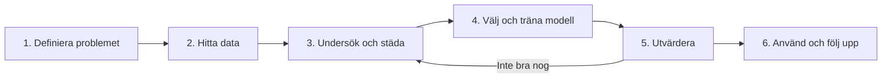

# Kapitel 7: Data och processen för AI-projekt

> **I det här kapitlet lär du dig**
> - hur ett AI-projekt går till från problem till färdig lösning
> - varför datakvalitet och val av data är så viktigt
> - hur du använder NumPy och Pandas för att undersöka och städa data
> - varför data delas upp i tränings- och testdata

En vanlig missuppfattning är att det svåra med AI är algoritmen. I verkligheten går en stor del av arbetet i de flesta projekt åt till att hitta, förstå och städa data. Det brukar sammanfattas med *garbage in, garbage out*: dåliga data ger dåliga resultat, hur smart modellen än är.

## Processen för problemlösning med AI



| Steg | Frågor du behöver svara på |
|---|---|
| **1. Definiera problemet** | Vad ska lösas? Behövs AI alls? Hur vet vi om det fungerar? |
| **2. Hitta data** | Finns det data? Får vi använda dem? Är de representativa? |
| **3. Undersök och städa** | Saknas värden? Finns fel eller dubbletter? |
| **4. Välj och träna modell** | Klassificering, regression eller något annat? |
| **5. Utvärdera** | Hur bra är resultatet på data modellen inte sett? Var blir det fel? |
| **6. Använd och följ upp** | Vem använder den? Fungerar den fortfarande om verkligheten ändras? |

Processen är sällan rak. Du kommer ofta tillbaka till tidigare steg.

## Datakvalitet och val av data

Bra data har flera egenskaper:

| Egenskap | Fråga | Exempel på problem |
|---|---|---|
| **Fullständighet** | Saknas värden? | Hälften av raderna saknar ålder |
| **Korrekthet** | Stämmer värdena? | Popularitet 700 på en skala till 100 |
| **Enhetlighet** | Är allt uttryckt på samma sätt? | Både "Sthlm" och "Stockholm" |
| **Aktualitet** | Är data gamla? | Prisdata från en annan tid |
| **Representativitet** | Liknar data verkligheten där modellen ska användas? | En röstmodell som mest hört en sorts dialekt |

**Val av data** är också en värdefråga. Vilka grupper är med? Är informationen tillräckligt relevant? Har du rätt att använda den? Om det handlar om personer kan GDPR gälla, så som du läste i [kapitel 5](05-lagar-och-regler.md). Därför använder vi påhittade data eller öppna datamängder i exemplen här.

## NumPy och Pandas

I Python är två bibliotek viktiga. **NumPy** arbetar med listor av tal, så kallade arrayer, och gör snabba beräkningar. **Pandas** arbetar med tabeller, så kallade DataFrames, där varje kolumn kan ha sitt eget namn och datatyp.

En tumregel: använd Pandas när du vill läsa in, filtrera och gruppera tabeller, och NumPy för att räkna på tal. Du kan köra koden i Google Colab, där båda biblioteken brukar finnas förinstallerade.

## Genomräknat exempel: låtdata som behöver städas

Vi har en påhittad tabell med låtar. Den innehåller tre problem: en dubblett, ett saknat värde och ett felaktigt tal.

```python
import numpy as np
import pandas as pd

låtar = pd.DataFrame({
    "låt":        ["Regn", "Sol", "Natt", "Regn", "Vind", "Dimma"],
    "artist":     ["Ada", "Bo", "Ada", "Ada", "Cia", "Bo"],
    "popularitet": [80, 65, np.nan, 80, 700, 30],
})

print("Medelvärde före städning:", round(låtar["popularitet"].mean(), 1))

låtar = låtar.drop_duplicates()                     # samma rad två gånger
låtar = låtar[låtar["popularitet"].between(0, 100)]  # tar bort 700 och saknade värden
print("Medelvärde efter städning:", round(låtar["popularitet"].mean(), 1))
print(låtar)

print(låtar.groupby("artist")["popularitet"].mean())

värden = låtar["popularitet"].to_numpy()
print("Högsta:", np.max(värden), " Över 50:", int(np.sum(värden > 50)))
```

```text
Medelvärde före städning: 191.0
Medelvärde efter städning: 58.3
     låt artist  popularitet
0   Regn    Ada         80.0
1    Sol     Bo         65.0
5  Dimma     Bo         30.0
artist
Ada    80.0
Bo     47.5
Name: popularitet, dtype: float64
Högsta: 80.0  Över 50: 2
```

Före städningen är medelvärdet 191, vilket är orimligt på en skala 0–100. Räkna själv: (80 + 65 + 80 + 700 + 30) / 5 = 955 / 5 = 191. Det saknade värdet hoppas över. Efter städningen är det (80 + 65 + 30) / 3 ≈ 58,3.

Observera att vi också förlorade artisten Cia, eftersom hennes enda låt hade ett felaktigt värde. Att ta bort data är ett val med konsekvenser. Hade hon varit en av få personer med en viss bakgrund i datamängden kunde modellen påverkas. Ibland kan du i stället ersätta saknade värden med till exempel medianen, eller kontrollera felet med den som samlade in data.

## Tränings- och testdata

Om du testar en modell på samma data som den tränats på vet du inte om den kan klara nya fall. Tänk dig en elev som fått provfrågorna i förväg: ett bra resultat säger inte mycket om kunskaperna. Därför delar vi data:

- **Träningsdata:** modellen lär sig av dem, ofta runt 70–80 procent.
- **Testdata:** används endast för att utvärdera modellen.

När en modell är bra på träningsdata men dålig på testdata har den **överanpassat** sig. Den har lärt sig utantill i stället för att hitta allmänna mönster. Om den tvärtom är dålig på båda har den **underanpassat** sig. Det ser du exempel på i nästa kapitel.

Ett annat problem är **dataläckage**, att information om svaret av misstag finns i egenskaperna. En modell som ska förutsäga om en patient blir sjuk får inte ha tillgång till en kolumn som bara fylls i efter att sjukdomen konstaterats. Resultatet ser fantastiskt ut, men fungerar inte i verkligheten.

## Att välja projekt

När du väljer projekt är det ofta bättre med ett litet problem med bra data än ett stort problem utan data. Bra projektfrågor kan se ut så här:

- Kan vi förutsäga en låts popularitet utifrån längd och tempo?
- Kan vi klassificera vin eller blommor från mätvärden?
- Kan vi gruppera liknande låtar utan etiketter?
- Kan en agent lära sig ett enkelt spel?

Innan du börjar: kolla att datamängden är öppen, inte innehåller personuppgifter och att du förstår vad varje kolumn betyder.

## Begrepp

- **NumPy:** Python-bibliotek för beräkningar med arrayer
- **Pandas:** Python-bibliotek för att arbeta med tabeller
- **DataFrame:** tabell i Pandas
- **Datakvalitet:** hur fullständiga, korrekta och användbara data är
- **Representativitet:** hur väl data speglar verkligheten modellen ska användas i
- **Tränings- och testdata:** data för inlärning respektive utvärdering
- **Överanpassning:** modellen minns träningsdata men klarar inte nya fall
- **Dataläckage:** information om svaret finns med i indata av misstag

## Testa dig själv

1. Vilka är stegen i processen för AI-projekt?
2. Varför utvärderar man inte på träningsdata?
3. Vad är skillnaden mellan NumPy och Pandas?
4. Vilka tre problem fanns i låttabellen?
5. Varför kan det vara problematiskt att bara radera rader med fel?
6. Ge ett exempel på en datamängd som inte är representativ.
7. Vad är dataläckage?

## Koppling till projektet

Det här kapitlet används i första delen av bootcampen i [AI - Projekt](../projekt/ai-projekt/README.md), och i början av ditt eget projekt när du ska välja och förbereda data.

## Läs mer

- [Pandas dokumentation](https://pandas.pydata.org/docs/)
- [NumPy dokumentation](https://numpy.org/doc/stable/)
- [Google Colab](https://colab.research.google.com/)

[← Föregående](06-mojligheter-och-risker.md) | [Innehåll](../README.md) | [Nästa →](08-klassificering-och-klustring.md)
