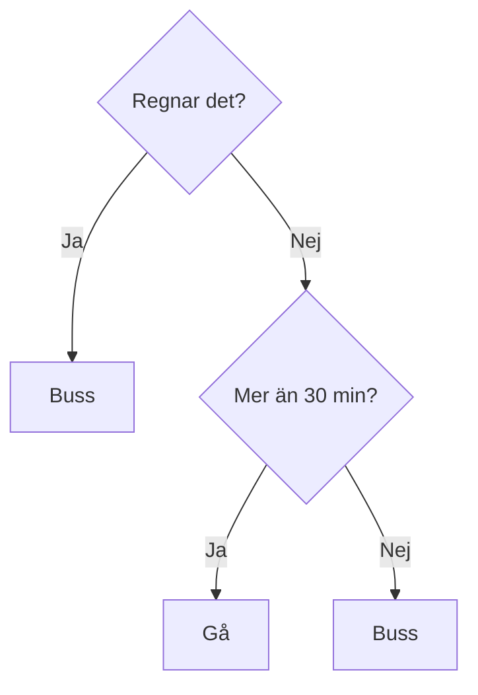

# Kapitel 8: Klassificering och klustring

> **I det här kapitlet lär du dig**
> - hur övervakat och oövervakat lärande skiljer sig
> - hur KNN, beslutsträd och slumpmässiga skogar fungerar
> - hur du utvärderar en modell och känner igen överanpassning
> - hur k-means hittar grupper utan facit

Om du ska gissa vilken musikgenre en okänd låt tillhör kan du jämföra med låtar du redan känner till. Om du ska avgöra om du ska ta bussen kan du ställa dig en rad ja-eller-nej-frågor. Två av de vanligaste metoderna inom maskininlärning fungerar på precis de sätten.

**Övervakat lärande** betyder att modellen tränas med rätt svar. **Klassificering** är övervakat lärande där svaret är en kategori. I **oövervakat lärande** finns inget facit, och modellen ska hitta en struktur själv.

## KNN: fråga grannarna

**K-Nearest Neighbors** (KNN) är enkel: för att klassa en ny punkt letar den upp de *k* närmaste punkterna i träningsdata och låter dem rösta. Avståndet mäts ofta med euklidiskt avstånd, alltså Pythagoras sats:

d = √((x₁ − x₂)² + (y₁ − y₂)²)

### Genomräknat exempel

Vi vill klassa punkten (4, 4). Träningsdata består av fem punkter.

```python
import math

# Euklidiskt avstånd: ny punkt (4, 4)
ny = (4, 4)
punkter = [("A", 2, 3, "röd"), ("B", 5, 5, "blå"), ("C", 6, 2, "blå"), ("D", 3, 6, "röd"), ("E", 8, 8, "blå")]
avstånd = sorted((round(math.dist(ny, (x, y)), 2), namn, klass) for namn, x, y, klass in punkter)
print(avstånd)

# Gini för en nod med a och b exempel
def gini(a, b):
    n = a + b
    return round(1 - (a / n) ** 2 - (b / n) ** 2, 3)

print("Start 6 buss, 4 gå:", gini(6, 4))
print("Regn 4 buss, 0 gå:", gini(4, 0))
print("Ej regn 2 buss, 4 gå:", gini(2, 4))
print("Viktat efter delning:", round(0.4 * gini(4, 0) + 0.6 * gini(2, 4), 3))
```

```text
[(1.41, 'B', 'blå'), (2.24, 'A', 'röd'), (2.24, 'D', 'röd'), (2.83, 'C', 'blå'), (5.66, 'E', 'blå')]
Start 6 buss, 4 gå: 0.48
Regn 4 buss, 0 gå: 0.0
Ej regn 2 buss, 4 gå: 0.444
Viktat efter delning: 0.266
```

Med k = 1 är B närmast, så svaret blir blå. Med k = 3 får vi B, A och D, två röda mot en blå, så svaret blir röd. Valet av k kan alltså ändra svaret. Ett litet k gör modellen känslig för enstaka konstiga punkter, medan ett mycket stort k suddar ut gränserna. Eftersom KNN jämför avstånd behöver alla egenskaper dessutom ha ungefär samma skala, annars styr den med störst tal.

## Beslutsträd: en följd av frågor

Ett **beslutsträd** ställer en fråga i taget. Frågorna väljs så att grupperna blir så rena som möjligt.



Algoritmen behöver ett mått på hur blandad en grupp är. Ett vanligt mått är **Gini**:

Gini = 1 − p₁² − p₂²

där p₁ och p₂ är andelen av varje klass. Gini 0 betyder att gruppen är helt ren.

Vi antar tio dagar: sex med buss och fyra med promenad. Beräkningen finns i koden ovan.

- Från början: 1 − 0,6² − 0,4² = 0,48.
- Frågan "regnar det?" ger två grupper. Fyra regniga dagar, alla med buss: Gini 0.
- Sex andra dagar, två med buss och fyra till fots: Gini ≈ 0,444.
- Viktat: 0,4 · 0 + 0,6 · 0,444 ≈ 0,266.

Gini sjunker från 0,48 till 0,266, så frågan är bra. Algoritmen prövar många frågor och väljer den som minskar Gini mest, och fortsätter sedan i varje gren.

Beslutsträd är lätta att förklara, vilket är en stor fördel när transparens är viktigt. Men ett djupt träd kan lära sig träningsdata utantill.

## Slumpmässiga skogar: många träd röstar

En **slumpmässig skog** tränar många träd, och varje träd får ett slumpmässigt urval av data och egenskaper. När en ny punkt ska klassas röstar träden, och majoriteten vinner. Vid regression tas i stället medelvärdet. Tanken är att enskilda träds misstag ska ta ut varandra.

## Experiment: jämför modellerna

Vi använder Iris, en klassisk datamängd med mått på 150 blommor av tre arter.

```python
from sklearn.datasets import load_iris
from sklearn.ensemble import RandomForestClassifier
from sklearn.model_selection import train_test_split
from sklearn.neighbors import KNeighborsClassifier
from sklearn.tree import DecisionTreeClassifier

X, y = load_iris(return_X_y=True)
X_tr, X_te, y_tr, y_te = train_test_split(X, y, test_size=0.3, random_state=42, stratify=y)

for k in [1, 3, 5, 15, 51]:
    knn = KNeighborsClassifier(n_neighbors=k).fit(X_tr, y_tr)
    print(f"KNN k={k:<3} testdata: {knn.score(X_te, y_te):.3f}")

for djup in [1, 2, 3, None]:
    träd = DecisionTreeClassifier(max_depth=djup, random_state=42).fit(X_tr, y_tr)
    print(f"Träd djup={djup}: träning {träd.score(X_tr, y_tr):.3f}  test {träd.score(X_te, y_te):.3f}")

skog = RandomForestClassifier(n_estimators=100, random_state=42).fit(X_tr, y_tr)
print(f"Skog 100 träd: test {skog.score(X_te, y_te):.3f}")

from sklearn.model_selection import cross_val_score
for namn, modell in [("Träd djup 3", DecisionTreeClassifier(max_depth=3, random_state=42)),
                     ("Skog 100 träd", RandomForestClassifier(n_estimators=100, random_state=42))]:
    print(f"{namn}: medel av 5 delningar {cross_val_score(modell, X, y, cv=5).mean():.3f}")
```

```text
KNN k=1   testdata: 0.933
KNN k=3   testdata: 0.956
KNN k=5   testdata: 0.978
KNN k=15  testdata: 0.956
KNN k=51  testdata: 0.889
Träd djup=1: träning 0.667  test 0.667
Träd djup=2: träning 0.971  test 0.889
Träd djup=3: träning 0.981  test 0.978
Träd djup=None: träning 1.000  test 0.933
Skog 100 träd: test 0.889
Träd djup 3: medel av 5 delningar 0.973
Skog 100 träd: medel av 5 delningar 0.967
```

Vad kan du läsa ut av resultatet?

- **KNN:** med k = 51 är resultatet sämst. Modellen frågar då ungefär hälften av alla träningspunkter och har blivit för grov.
- **Träd:** djup 1 är **underanpassat**. Ett obegränsat träd får 100 procent på träningsdata men sämre på testdata än djup 3, ett tecken på **överanpassning**.
- **Skog:** en skog brukar vara stabilare än ett enskilt träd, men här blev den inte bättre. Skillnaden är inte så stor som den ser ut: testdatan består av bara 45 blommor, och en blomma motsvarar 2,2 procentenheter. Resultaten från 5 olika delningar (**korsvalidering**) visar att träd och skog är ungefär lika bra på den här lätta datamängden.

Lärdom: dra inte för stora slutsatser av en enda test. Noggrannhet säger inte heller allt. Om 99 av 100 patienter är friska får en modell som alltid svarar "frisk" 99 procent rätt, och är ändå värdelös. En **förväxlingsmatris** visar vilka klasser som blandas ihop.

## Oövervakat lärande: k-means

**K-means** är en klustringsalgoritm. Den får data utan svar och delar in dem i *k* grupper:

1. Lägg ut *k* startpunkter.
2. Tilldela varje datapunkt till närmaste startpunkt.
3. Flytta varje startpunkt till mitten av sin grupp.
4. Upprepa steg 2 och 3 tills grupperna inte ändras.

Vi kör k-means på Iris utan att visa arterna, och jämför efteråt.

```python
import pandas as pd
from sklearn.cluster import KMeans
from sklearn.datasets import load_iris

X, y = load_iris(return_X_y=True)
kluster = KMeans(n_clusters=3, n_init=10, random_state=42).fit_predict(X)
print(pd.crosstab(y, kluster, rownames=["art"], colnames=["kluster"]))
```

```text
kluster   0   1   2
art                
0         0  50   0
1        48   0   2
2        14   0  36
```

Numret på ett kluster betyder inget i sig. Alla 50 blommor av art 0 hamnar i samma kluster, utan att modellen har fått veta något om arterna. Art 1 och 2 blandas lite, vilket visar att de liknar varandra mer. Klustring används till exempel för att dela in kunder i grupper, eller upptäcka ovanliga mönster.

## Begrepp

- **Övervakat lärande:** träning med rätt svar
- **Oövervakat lärande:** träning utan rätt svar
- **Klassificering:** välja en kategori
- **KNN:** klassar efter de närmaste grannarna
- **Beslutsträd:** en följd av frågor som leder till ett svar
- **Gini:** mått på hur blandad en grupp är
- **Slumpmässig skog:** många träd som röstar
- **Underanpassning:** modellen är för enkel
- **Korsvalidering:** testa på flera olika delningar av data
- **Klustring:** dela in data i grupper utan facit

## Testa dig själv

1. Vad händer om k är väldigt litet i KNN? Väldigt stort?
2. Varför behöver egenskaper ofta ha samma skala i KNN?
3. Vad mäter Gini?
4. Varför presterar ett obegränsat träd ofta sämre på testdata?
5. Varför kan en skog vara bättre än ett träd?
6. Varför ska man inte lita på en enda delning av testdata?
7. När är noggrannhet ett dåligt mått?

## Övningar

**Grund.** Beräkna avståndet mellan punkterna (1, 1) och (4, 5).

<details><summary>Svar</summary>

√(3² + 4²) = √25 = 5.

</details>

**Grund.** En nod innehåller 3 röda och 2 blå. Beräkna Gini.

<details><summary>Svar</summary>

1 − 0,6² − 0,4² = 0,48.

</details>

**Vidare.** Byt ut Iris mot Wine (`load_wine`) i koden. Vilken modell fungerar bäst? Prova också att skala data med `StandardScaler` för KNN.

**Utmaning.** Träna ett beslutsträd på `load_breast_cancer`. Skriv ut en förväxlingsmatris med `confusion_matrix`. Vilken typ av fel är allvarligast i det här fallet, och hur kan du påverka det?

## Koppling till projektet

Under bootcampen i [AI - Projekt](../projekt/ai-projekt/README.md) tränar du KNN, beslutsträd och slumpmässiga skogar i Google Colab. Metoderna passar bra i ett eget projekt om du vill klassificera något.

## Läs mer

- [scikit-learn om grannmetoder](https://scikit-learn.org/stable/modules/neighbors.html)
- [scikit-learn om beslutsträd](https://scikit-learn.org/stable/modules/tree.html)
- [scikit-learn om klustring](https://scikit-learn.org/stable/modules/clustering.html)

[← Föregående](07-data-och-process.md) | [Innehåll](../README.md) | [Nästa →](09-regression-och-neurala-natverk.md)
