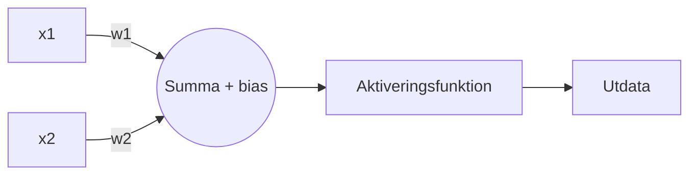

# Kapitel 9: Regression, neurala nätverk och bilder

> **I det här kapitlet lär du dig**
> - hur linjär regression gör prediktioner och hur du tolkar den
> - hur en modell tränas med gradientnedstigning
> - hur en perceptron och ett neuralt nätverk fungerar
> - hur datorer känner igen objekt i bilder

Hur kan en dator lära sig att känna igen en handskriven siffra? Svaret börjar faktiskt med något du redan kan från matematiken: en rät linje. Det här kapitlet tar dig från en linje till ett neuralt nätverk i några steg.

## Linjär regression

**Regression** är övervakat lärande där svaret är ett tal, till exempel ett pris eller en tid. I **linjär regression** söker vi en linje y = ax + b som passar data så bra som möjligt. Linjen väljs oftast så att summan av de kvadrerade felen blir minst möjlig (minsta kvadratmetoden).

### Genomräknat exempel

Vi har påhittade mätvärden: träningstimmar per vecka och tid på 3 km.

```python
import numpy as np

# Påhittade mätvärden: träningstimmar per vecka och tid på 3 km (minuter)
x = np.array([1, 2, 3, 4, 5, 6, 7, 8])
y = np.array([19.5, 18.8, 18.4, 17.5, 17.1, 16.2, 15.9, 15.1])

a, b = np.polyfit(x, y, 1)
print(f"Modell: y = {a:.3f}x + {b:.3f}")
print(f"Prediktion 5,5 h: {a * 5.5 + b:.2f}")
print(f"Prediktion 40 h: {a * 40 + b:.2f}")

gissning = a * x + b
r2 = 1 - np.sum((y - gissning) ** 2) / np.sum((y - y.mean()) ** 2)
print(f"R2 = {r2:.3f}")

# Samma modell med gradientnedstigning
m, c = 0.0, 0.0
for steg in range(20000):
    fel = (m * x + c) - y
    m -= 0.01 * 2 * np.mean(fel * x)
    c -= 0.01 * 2 * np.mean(fel)
print(f"Gradientnedstigning: y = {m:.3f}x + {c:.3f}")
```

```text
Modell: y = -0.623x + 20.114
Prediktion 5,5 h: 16.69
Prediktion 40 h: -4.79
R2 = 0.993
Gradientnedstigning: y = -0.623x + 20.114
```

Så här tolkar du resultatet:

- **Lutningen** a = −0,623 betyder att tiden i den här datan sjunker med cirka 0,62 minuter per extra träningstimme.
- **Interceptet** b = 20,114 är modellens gissning vid 0 timmars träning.
- **R²** = 0,993 visar att linjen förklarar nästan all variation i de här mätvärdena.
- Prediktionen för 5,5 timmar ligger inom datans område och är rimlig: 16,69 minuter.
- Prediktionen för 40 timmar ger en negativ tid, −4,79 minuter, vilket är omöjligt. Att gissa utanför det område man har data för kallas **extrapolering** och kan bli helt fel.

Att två saker samvarierar betyder inte att den ena orsakar den andra. I det här påhittade fallet är det rimligt att tro på ett orsakssamband, men i verkliga data kan det finnas andra förklaringar.

## Gradientnedstigning

`np.polyfit` hittar den bästa linjen direkt. Stora modeller tränas i stället stegvis genom **gradientnedstigning**:

1. Börja med en gissning.
2. Beräkna felet.
3. Ändra parametrarna lite åt det håll som minskar felet.
4. Upprepa.

Hur stort steget är bestäms av **inlärningstakten** (*learning rate*). I koden är den 0,01. Tänk dig att du går nerför en dal i dimma: för stora kliv och du snubblar förbi botten, för små kliv och du kommer aldrig fram. Koden ger samma linje som `np.polyfit`.

## Perceptronen

En **perceptron** är den enklaste byggstenen i neurala nätverk. Den multiplicerar varje indata med en **vikt**, lägger ihop resultaten och ett **bias**-värde, och skickar summan genom en **aktiveringsfunktion**.



Här lär sig en perceptron logiskt OCH: svaret ska bara vara 1 om båda indata är 1.

```python
# En perceptron som lär sig logiskt OCH
data = [((0, 0), 0), ((0, 1), 0), ((1, 0), 0), ((1, 1), 1)]
w1, w2, bias = 0.0, 0.0, 0.0
lärtakt = 0.1

def gissa(x1, x2):
    return 1 if w1 * x1 + w2 * x2 + bias > 0 else 0

for varv in range(1, 21):
    fel_antal = 0
    for (x1, x2), facit in data:
        fel = facit - gissa(x1, x2)
        if fel != 0:
            w1 += lärtakt * fel * x1
            w2 += lärtakt * fel * x2
            bias += lärtakt * fel
            fel_antal += 1
    if fel_antal == 0:
        print("Klar efter varv", varv)
        break

print(round(w1, 1), round(w2, 1), round(bias, 1))
print([gissa(x1, x2) for (x1, x2), _ in data])
```

```text
Klar efter varv 6
0.2 0.1 -0.2
[0, 0, 0, 1]
```

Kontrollera (1, 1): 0,2 + 0,1 − 0,2 = 0,1, som är större än noll. Alltså blir svaret 1. Ingen har programmerat in vikterna, utan de hittades genom att felen justerade dem.

## Neurala nätverk

En perceptron kan bara dra en rät gräns. När många kopplas ihop i lager får vi ett **neuralt nätverk**. Indata går in i ett indatalager, passerar **dolda lager** och blir utdata. Aktiveringsfunktioner som *ReLU* och *sigmoid* gör att nätverket kan beskriva krokiga samband.

Träningen har två steg:

- **Feedforward:** data flödar genom nätverket och ger en gissning.
- **Backpropagation:** felet räknas bakåt genom lagren för att avgöra hur varje vikt ska ändras.

Nätverk med många dolda lager kallas **djupinlärning**. Språkmodellerna i [kapitel 2](02-sprakmodeller.md) är exempel.

Här tränar vi nätverk av olika storlek på små bilder av handskrivna siffror.

```python
from sklearn.datasets import load_digits
from sklearn.model_selection import train_test_split
from sklearn.neural_network import MLPClassifier

X, y = load_digits(return_X_y=True)
X = X / 16
X_tr, X_te, y_tr, y_te = train_test_split(X, y, test_size=0.3, random_state=42, stratify=y)
print("Bildstorlek:", X.shape[1], "pixlar, antal bilder:", len(X))

for lager in [(5,), (20,), (100,), (100, 50)]:
    nät = MLPClassifier(hidden_layer_sizes=lager, max_iter=1000, random_state=42).fit(X_tr, y_tr)
    print(f"Dolda lager {str(lager):<10} test: {nät.score(X_te, y_te):.3f}")
```

```text
Bildstorlek: 64 pixlar, antal bilder: 1797
Dolda lager (5,)       test: 0.909
Dolda lager (20,)      test: 0.970
Dolda lager (100,)     test: 0.981
Dolda lager (100, 50)  test: 0.980
```

Fler noder hjälper till att börja med, men efter en viss punkt blir vinsten liten. Större är inte alltid bättre, och det kostar mer att träna.

## Datorseende och objektigenkänning

För en dator är en bild bara ett rutnät av tal. I exemplet ovan är varje bild 8 gånger 8 pixlar, alltså 64 tal. Riktiga bilder är mycket större, så man använder ofta **faltningsnätverk** (*CNN*). De letar efter små mönster som kanter och hörn, och kombinerar dem till mer sammansatta former.

Det finns flera nivåer av bildförståelse:

| Uppgift | Fråga | Exempel på svar |
|---|---|---|
| **Bildklassificering** | Vad är det här för bild? | "En hund" |
| **Objektigenkänning** | Vad finns i bilden, och var? | "En hund här, en bil där", med rutor runt |
| **Segmentering** | Vilka pixlar tillhör vad? | Varje pixel märks |

Objektigenkänning används i självkörande bilar, industrikontroll och kameror. En färdigtränad modell kan användas utan att du tränar den själv, till exempel med `object-detection` i [Hugging Face Transformers](https://huggingface.co/docs/transformers/en/main_classes/pipelines). Tänk på att bilder av människor är personuppgifter.

## Begrepp

- **Regression:** prediktion av ett tal
- **Extrapolering:** prediktion utanför datans område
- **Gradientnedstigning:** träning genom små steg som minskar felet
- **Inlärningstakt:** hur stora stegen är
- **Perceptron:** enkel modell med vikter, bias och aktiveringsfunktion
- **Dolt lager:** lager mellan indata och utdata
- **Backpropagation:** räkna felet bakåt för att justera vikter
- **CNN:** nätverk som är särskilt bra på bilder
- **Objektigenkänning:** att hitta och namnge objekt i en bild

## Testa dig själv

1. Vad betyder lutningen i exemplet med löpträning?
2. Varför är prediktionen för 40 timmar orimlig?
3. Vad händer om inlärningstakten är för stor?
4. Vad gör en vikt och ett bias i en perceptron?
5. Vad är skillnaden mellan feedforward och backpropagation?
6. Vad är skillnaden mellan bildklassificering och objektigenkänning?
7. Varför kan fler noder bli slöseri?

## Koppling till projektet

Under bootcampen i [AI - Projekt](../projekt/ai-projekt/README.md) arbetar du med linjär regression och neurala nätverk. Om ditt eget projekt ska förutsäga ett tal är regression ett bra första val.

## Läs mer

- [scikit-learn: linjära modeller](https://scikit-learn.org/stable/modules/linear_model.html)
- [scikit-learn: neurala nätverk](https://scikit-learn.org/stable/modules/neural_networks_supervised.html)
- [Hugging Face Transformers pipelines](https://huggingface.co/docs/transformers/en/main_classes/pipelines)

[← Föregående](08-klassificering-och-klustring.md) | [Innehåll](../README.md) | [Nästa →](10-sokning-agenter-robotik.md)
