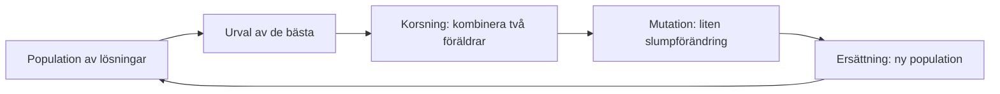
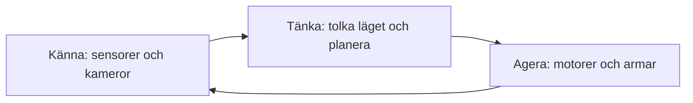

# Kapitel 10: Sökning, spelagenter, genetiska algoritmer och robotik

> **I det här kapitlet lär du dig**
> - hur sökning hittar en väg genom ett stort antal möjligheter
> - hur en spelagent kan välja bästa drag
> - hur en genetisk algoritm hittar bra lösningar
> - hur robotar kombinerar sensorer, beslut och rörelser

Inte all AI bygger på inlärning från data. En schackdator, en GPS och en robot i ett lager använder alla **sökning**: att systematiskt undersöka möjligheter och välja den bästa. I det här kapitlet ser du att antalet möjligheter snabbt blir enormt, och hur AI ändå kan lösa problemen.

## Sökning: hitta en väg

Tänk dig en robot som ska ta sig från start (S) till mål (M) i ett rutnät med väggar (#). **Bredden-först-sökning** undersöker först alla rutor ett steg bort, sedan alla två steg bort, och så vidare. Eftersom den går utåt i jämn takt hittar den alltid en kortaste väg.

```python
from collections import deque

karta = ["S..#....",
         ".#.#.##.",
         ".#...#..",
         ".####.#.",
         "......#M"]

def hitta(tecken):
    for r, rad in enumerate(karta):
        if tecken in rad:
            return (r, rad.index(tecken))

def bredden_först(start, mål):
    kö = deque([start])
    kom_från = {start: None}
    besökta = 0
    while kö:
        nu = kö.popleft()
        besökta += 1
        if nu == mål:
            väg = []
            while nu is not None:
                väg.append(nu)
                nu = kom_från[nu]
            return len(väg) - 1, besökta
        r, k = nu
        for ny in [(r+1, k), (r-1, k), (r, k+1), (r, k-1)]:
            if 0 <= ny[0] < len(karta) and 0 <= ny[1] < len(karta[0]) \
               and karta[ny[0]][ny[1]] != "#" and ny not in kom_från:
                kom_från[ny] = nu
                kö.append(ny)
    return None, besökta

steg, besökta = bredden_först(hitta("S"), hitta("M"))
print("Kortaste vägen:", steg, "steg. Undersökta rutor:", besökta)
```

```text
Kortaste vägen: 15 steg. Undersökta rutor: 27
```

Programmet behöver ingen träningsdata, bara en beskrivning av problemet. Algoritmen **A\*** är en förbättring som använder en uppskattning av hur långt det är kvar till målet, så att den slipper undersöka lika många rutor.

## Spelagenter

En **agent** är ett program som uppfattar sin omgivning och väljer handlingar för att nå ett mål. Vi tittar på spelet Nim: spelarna tar i tur och ordning 1, 2 eller 3 stickor, och den som tar den sista stickan vinner.

Agenten söker igenom alla möjliga spelförlopp. Ett läge är vinnande om det finns ett drag som lämnar motståndaren i ett förlorande läge. Det är samma tankesätt som i **minimax**, en metod som används i spel för två spelare.

```python
# Nim: ta 1-3 stickor per drag, den som tar sista stickan vinner
from functools import lru_cache

@lru_cache(maxsize=None)
def kan_vinna(stickor):
    return any(not kan_vinna(stickor - ta) for ta in (1, 2, 3) if ta <= stickor)

def bästa_drag(stickor):
    for ta in (1, 2, 3):
        if ta <= stickor and not kan_vinna(stickor - ta):
            return ta
    return 1  # förlorande läge: ta en och hoppas på ett misstag

for n in [5, 6, 7, 8, 13]:
    print(f"{n} stickor: kan vinna={kan_vinna(n)}, drag={bästa_drag(n)}")
```

```text
5 stickor: kan vinna=True, drag=1
6 stickor: kan vinna=True, drag=2
7 stickor: kan vinna=True, drag=3
8 stickor: kan vinna=False, drag=1
13 stickor: kan vinna=True, drag=1
```

Lägg märke till mönstret: 8 stickor är förlorande. Det gäller alla tal i fyrans tabell: 4, 8, 12 och så vidare. En människa upptäcker den regeln och kan förklara den i en mening: lämna alltid ett tal i fyrans tabell. Agenten räknar sig fram till samma resultat utan att någonsin formulera regeln. Det är ett bra exempel på jämförelsen i [kapitel 4](04-manniska-och-ai.md).

Schack och go har för många möjliga spelförlopp för att söka igenom allt. Då kombinerar man sökning med en uppskattning av hur bra ett läge är. Agenter kan också tränas med **förstärkningsinlärning**: de spelar om och om igen och får belöning eller straff. Det var en viktig del av AlphaGo.

## Genetiska algoritmer

**Handelsresandeproblemet** (*Traveling Salesman Problem*, TSP) går ut på att hitta den kortaste rundturen genom alla städer. Antalet rundturer ökar väldigt snabbt: med 52 städer finns det 52! ≈ 8 · 10⁶⁷ sätt att ordna städerna. Därför går det inte att pröva alla.

En **genetisk algoritm** lånar idéer från evolutionen:



```python
import itertools, math, random

random.seed(7)
städer = [(random.randint(0, 100), random.randint(0, 100)) for _ in range(9)]

def längd(rutt):
    return sum(math.dist(städer[rutt[i]], städer[rutt[(i + 1) % len(rutt)]]) for i in range(len(rutt)))

def korsning(a, b):
    i, j = sorted(random.sample(range(len(a)), 2))
    mitt = a[i:j]
    rest = [s for s in b if s not in mitt]
    return rest[:i] + mitt + rest[i:]

def mutera(rutt, sannolikhet=0.3):
    rutt = rutt[:]
    if random.random() < sannolikhet:
        i, j = random.sample(range(len(rutt)), 2)
        rutt[i], rutt[j] = rutt[j], rutt[i]
    return rutt

population = [random.sample(range(9), 9) for _ in range(30)]
print("Bästa slumprutten:", round(min(map(längd, population)), 1))

for generation in range(60):
    population.sort(key=längd)
    föräldrar = population[:10]                      # urval
    barn = [mutera(korsning(*random.sample(föräldrar, 2))) for _ in range(20)]
    population = föräldrar + barn                    # ersättning

print("Genetisk algoritm:", round(min(map(längd, population)), 1))
bäst = min(([0] + list(p) for p in itertools.permutations(range(1, 9))), key=längd)
print("Bästa möjliga:    ", round(längd(bäst), 1))
print("Antal olika rutter:", math.factorial(8) // 2)
```

```text
Bästa slumprutten: 329.3
Genetisk algoritm: 259.5
Bästa möjliga:     252.7
Antal olika rutter: 20160
```

Med nio städer kan datorn fortfarande pröva alla rutter och se att den bästa är 252,7. Den genetiska algoritmen kom fram till 259,5, nära men inte exakt det bästa. Det är typiskt: metoden hittar ofta en **bra lösning**, men garanterar inte den bästa. Fördelen är att den också fungerar när antalet rutter är för stort att pröva.

Du kan påverka resultatet med till exempel populationens storlek, sannolikheten för mutation och urvalsmetoden. Utan mutation riskerar populationen att fastna, eftersom alla lösningar blir för lika.

## Robotik

En **robot** är en maskin som kan uppfatta sin omgivning och agera i den. Många robotar följer samma grundmönster:



Flera av teknikerna från den här boken samverkar i en robot:

| Delproblem | Teknik |
|---|---|
| Förstå vad som syns i kameran | Objektigenkänning |
| Hitta vägen | Sökning, till exempel A\* |
| Bedöma om en maskin snart går sönder | Prediktion, regression |
| Lära sig gripa saker | Förstärkningsinlärning eller träning med simulering |
| Förstå talade instruktioner | NLP och språkmodeller |

Robotik är svårare än det låter. Sensorer ger felaktiga mätningar, världen ändras hela tiden och ett fel kan orsaka fysisk skada. Att spela schack på världsmästarnivå är lättare för en dator än att duka av ett bord i ett okänt hem, ett exempel på det som ibland kallas **Moravecs paradox**: det som är svårt för oss är ibland lätt för datorer och tvärtom.

## Begrepp

- **Sökning:** att systematiskt undersöka möjliga lösningar
- **Bredden-först-sökning:** sökning som går utåt, ett steg i taget
- **Agent:** program som uppfattar omgivningen och handlar för att nå ett mål
- **Minimax:** spelstrategi där varje spelare antas spela så bra som möjligt
- **Förstärkningsinlärning:** lärande genom belöning och straff
- **Genetisk algoritm:** söker lösningar med urval, korsning och mutation
- **Robot:** maskin som känner av omgivningen och agerar i den

## Testa dig själv

1. Varför hittar bredden-först-sökning en kortaste väg?
2. Vad betyder det att ett läge i Nim är förlorande?
3. Hur skiljer sig agentens och människans lösning av Nim?
4. Varför kan man inte pröva alla rutter i TSP med många städer?
5. Vad gör urval, korsning och mutation?
6. Varför garanterar inte en genetisk algoritm den bästa lösningen?
7. Vad menas med att känna, tänka och agera?

## Koppling till projektet

Du använder genetiska algoritmer i bootcampen i [AI - Projekt](../projekt/ai-projekt/README.md). Sökning eller en spelagent kan också vara ett bra eget projekt om du inte vill jobba med maskininlärning på data.

## Läs mer

- [Google Colab](https://colab.research.google.com/)
- [AlphaGo-projektet hos DeepMind](https://deepmind.google/research/alphago/)

[← Föregående](09-regression-och-neurala-natverk.md) | [Innehåll](../README.md) | [Nästa →](../README.md)
